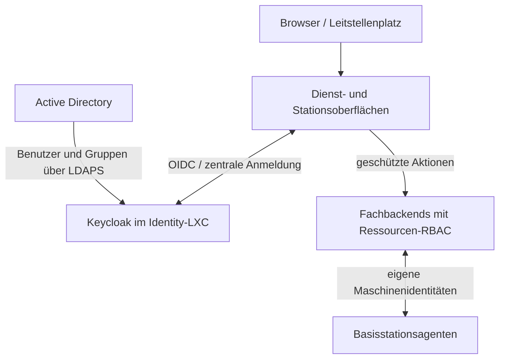

# Ideen-Ergänzung: SSO mit AD und Ressourcen-RBAC

| Feld | Wert |
| --- | --- |
| Zugehörige Aufgabe | NETCORE-IAM-01 / Z04 |
| Datum | 2026-10-14, Europe/Berlin |
| Anlass | Nutzerwunsch: gemeinsame Anmeldung für Dienst-WebUIs und Basisstationen, passend zum vorhandenen AD und zum NetCore-RBAC |
| Status | Konzept / geplant; keine Installation, Codeänderung oder Betriebsabnahme durch diese Ergänzung |
| Maßgebliche Planung | [IAM-Roadmap](../roadmaps/zentrale-anmeldung-und-berechtigungen.md); Reihenfolge in der [Gesamtroadmap](../roadmaps/gesamtroadmap.md) |

## 1. Ziel und Zuständigkeiten

Eine Anmeldung mit dem vorhandenen AD-Konto soll den Wechsel zwischen angebundenen Basisstations-Dashboards, Control Room, zentralen Dienstoberflächen und später NetCore Drive ermöglichen. Jede Anwendung erhält eine nachvollziehbare Benutzeridentität; die jeweilige Fachaktion bleibt an ein ausdrückliches Recht und ihren Ressourcenbereich gebunden.

AD führt interne menschliche Benutzer und die dafür vorgesehenen Gruppen. Keycloak ist der bevorzugte Identity-Provider-Kandidat für SSO und Tokenausstellung. NetCore setzt Ressourcenrechte im jeweiligen Backend durch. Produktversion, Betriebsparameter und Protokollvertrag werden in IAM M1 festgelegt; die Aufnahme der Idee ist keine bereits abgeschlossene Architekturentscheidung.

Das Diagramm zeigt die Vertrauensbeziehungen, keine zusätzliche Funk- oder Medienroute. Web-Anmeldung, Maschinenzugang und TETRA-Teilnehmerauthentisierung bleiben getrennte Identitätsklassen. Die laufende Funkvermittlung benötigt weder eine Browsersitzung noch eine erreichbare Web-Anmeldung.

## 2. AD und Identity-Dienst

- **AD-Anbindung:** LDAPS mit geprüfter Zertifikatskette, eingeschränktem Lesekonto und begrenzter Benutzer-/Gruppensuche. Die Federation wird lesend eingerichtet; NetCore und Keycloak verändern darüber keine AD-Konten oder Gruppen. AD-Passwörter werden nicht als lokale Ersatzpasswörter übernommen.
- **Betrieb:** eigener Identity-LXC mit Keycloak und zunächst eigener PostgreSQL-Datenbank; HTTPS, stabiler DNS-Name und fester Issuer. Ein einzelner LXC ist keine Hochverfügbarkeit. Höhere Verfügbarkeit folgt als eigene Ausbaustufe.
- **Identitätsbezug:** Anwendungen referenzieren die zentrale Identität über das Paar `issuer` / `subject`. Die AD-Anbindung muss ein stabiles Verzeichnismerkmal verwenden. Namens- oder E-Mail-Änderungen dürfen keinen neuen Besitzer erzeugen; bestehende lokale Konten werden nur über eine bestätigte Zuordnung migriert.
- **Weitere Identitäten:** begrenzte externe Drive-Gäste und lokale Notfallkonten sind eigene, ausdrücklich eingerichtete Identitäten. Gäste benötigen kein internes AD-Konto und erhalten keine internen Dienstrollen.
- **Privilegierte Anmeldung:** MFA für administrative Rollen und besonders sensible Aktionen vorsehen. Kerberos/SPNEGO kann später die vorhandene AD-Anmeldung eines passend eingerichteten Arbeitsplatzes verwenden; DNS, SPNs, Zeit und Browserkonfiguration sind zuvor zu prüfen.

Private Domänenparameter, Hostadressen, Bind-Zugangsdaten und Schlüssel werden bei der Einrichtung bereitgestellt und nicht in dieser öffentlichen Konzeptdatei abgelegt.

## 3. Anbindung der Oberflächen

| Oberfläche | Geplanter Anschluss | Durchsetzung |
| --- | --- | --- |
| Eigene NetCore-Dienste und TBS-Dashboards | Native OIDC-Integration über den gemeinsamen Rust-Baustein `netcore-auth` | Backend prüft Identität, Einzelrecht und Zielressource bei jeder geschützten Aktion |
| Fremdanwendungen mit SSO-Unterstützung | Vorhandene OIDC- oder SAML-Anbindung der Anwendung | Deren Rollen-/Gruppenmapping und tatsächliche Ressourcenrechte gesondert abnehmen |
| Fremdanwendungen ohne SSO | Anmeldeproxy, beispielsweise `oauth2-proxy`, als begrenzter Integrationsweg | Proxy begrenzt den Dienstzugang; interne Rechte und gegebenenfalls verbleibenden Anwendungslogin ausdrücklich prüfen |

Für eigene Webanwendungen sind Authorization Code mit PKCE, `state`-/`nonce`-Prüfung, sichere anwendungsspezifische Browser-Sessions, CSRF-Schutz und ein definiertes Logout vorgesehen. Tokens nach Möglichkeit serverseitig halten. Die gemeinsame IdP-Sitzung ermöglicht SSO; jede Anwendung führt ihre eigene begrenzte Sitzung.

OIDC-Clients erhalten festgelegte Audiences und exakte HTTPS-Callback-Adressen. Access Tokens werden nur von ihren vorgesehenen Empfängern akzeptiert. ID Tokens ersetzen keine API-Zugangsberechtigung. Umfang und Lebensdauer von Claims und Ressourcen-Zuweisungen werden versioniert festgelegt.

Ein Proxy ist kein Ersatz für fehlende Fachautorisierung. Direkte Backend-Ports müssen im Proxy-Modell vor Umgehung geschützt sein. Vom Client gelieferte Identitätsheader werden entfernt; ein Backend darf solche Header ausschließlich über einen authentisierten, festgelegten Proxy-Pfad übernehmen. Unterstützt eine Fremdanwendung keine feinen Rechte, wird diese Grenze dokumentiert und keine vollständige RBAC-Integration behauptet.

## 4. AD-Gruppen, Rollen und Ressourcen

Die folgenden Gruppennamen sind Vorschläge. Eine erlaubte AD-Gruppe wird ausdrücklich auf eine NetCore-Rolle abgebildet; andere AD-Gruppen erhalten keine impliziten NetCore-Rechte.

| Beispielgruppe | Rolle | Vorgesehener Umfang |
| --- | --- | --- |
| `GRP_NetCore_Viewer` | `viewer` | Freigegebene Zustände und Diagnosen lesen |
| `GRP_NetCore_Operator` | `operator` | Erlaubte Betriebsaktionen, beispielsweise SDS und Gruppenbedienung |
| `GRP_NetCore_Technician` | `technician` | Diagnose, Konfiguration, Updates und Wartung zugewiesener Stationen / Dienste |
| `GRP_NetCore_Auditor` | `auditor` | Audit und ausdrücklich freigegebene Exporte |
| `GRP_NetCore_Admin` | `administrator` | Benutzerzuordnungen und Rechte im delegierten Bereich verwalten |

Die vorhandene geplante Besitzerrolle `owner` bleibt eine ausdrücklich zugewiesene netzweite Sonderrolle. AD-Domänenadministration führt nicht automatisch zu dieser Rolle. Delegierte Administratoren dürfen ihren Zuständigkeitsbereich nicht durch eigene Rollenzuweisungen erweitern.

Eine wirksame Zuweisung besteht aus **Identität + Rolle/Einzelrecht + Ressourcenbereich**. AD liefert Grundrollen; Stations-, Dienst-, Gruppen- und Dateirechte erhalten eine eindeutige fachliche Autorität im jeweiligen Backend. Ein zusätzliches zentrales Policy-System ist keine Voraussetzung des ersten Piloten.

Beispiel: Ein Techniker darf TBS-01 konfigurieren, TBS-02 nur ansehen und hat auf TBS-03 keinen Zugriff. Ein Operator darf SDS ausschließlich an zugewiesene Ziele senden. Aufnahmezugriff, Export, Senden und Änderungen an HF-Parametern werden gesondert berechtigt. Ein Dienstadministrator erhält dadurch keinen pauschalen Zugriff auf Gesprächsinhalte oder Drive-Dateien.

Ausgeblendete UI-Elemente dienen der Bedienung. Verbindlich sind die serverseitigen Prüfungen für HTTP-APIs, Exporte und geschützte Befehle über WebSocket-/Langzeitverbindungen. Neue oder nicht zugeordnete Rechte werden standardmäßig verweigert.

## 5. Basisstationen, Deployment und Maschinenzugänge

Der vorhandene Dashboard-Login wird im Pilot kontrolliert ersetzt. Jede migrierte Station erhält ihren Ressourcenbezug und die nötige OIDC-Client-Konfiguration über einen vertrauenswürdigen Provisionierungspfad. Reguläre menschliche Zugangsdaten werden danach aus ihrer `config.toml` entfernt; ein lokaler Notzugang wird unabhängig davon verwaltet.

Die Tokenprüfung kontrolliert Signatur, erlaubten Algorithmus, Issuer, Audience, Ablauf und Tokenart. Vertrauenswürdige öffentliche Schlüssel werden mit begrenzter Cache- und Rotationsregel vorgehalten. Ein unbekannter Schlüssel oder ein nicht prüfbares Token öffnet keinen Zugang. Der Cache ermöglicht weder neue AD-Anmeldung noch Tokenverlängerung.

Controller, Stationsagenten und Automationen erhalten jeweils eigene Maschinenidentitäten mit begrenzten Aufgaben und Zielressourcen. Individuelle Zertifikate für mTLS sind der vorgeschlagene Transportweg; ihre Ausstellung, Rotation und Sperrung sind Teil des späteren Maschinenvertrags. Ein Maschinenzugang erbt keine Browser- oder Besitzerrechte. Bei benutzerveranlassten Aufträgen bleibt der geprüfte Benutzer-/Auditkontext erhalten; Agenten akzeptieren nur erlaubte, authentisierte Kommandos.

Discovery findet Endpunkte. Vertrauen in Issuer, Zertifikate oder neue Clients entsteht durch kontrolliertes Enrollment. Die bloße Entdeckung eines Identity-Dienstes genügt dafür nicht. Wiederbereitstellung nach Datenträgerwechsel, Widerruf alter Identitäten und Secret-Übergabe gehören zur Abnahme; Geheimnisse werden nicht in Git, Images mit allgemeiner Verteilung oder Logs eingebettet.

## 6. Sitzungen, Sperren und Ausfall

Fünf Minuten für Access Tokens sind ein zu prüfender Startvorschlag, keine bereits konfigurierte Frist oder garantierte Gesamtsperrzeit. M1 definiert die maximal zulässige Verzögerung für AD-Sperren und Rechteentzug einschließlich Verzeichnissynchronisation, Caches, Anwendungssitzungen und offenen Verbindungen.

| Situation | Geplantes Verhalten / zu entscheidende Grenze |
| --- | --- |
| AD oder Identity-Dienst nicht erreichbar | Laufende Funkvermittlung arbeitet weiter; neue AD-Passwortanmeldung beziehungsweise Token-Erneuerung bleibt von den benötigten Diensten abhängig |
| Vorhandener Verwaltungszugang | Nur innerhalb definierter Token-/Sitzungsgrenzen und mit prüfbaren Vertrauensdaten; ein Cookie darf diese Grenzen nicht umgehen |
| Kritische Schreibaktion bei fehlendem aktuellen Berechtigungsstand | Verweigern; keine unbeschränkte Offline-Verlängerung alter Rechte |
| Benutzer oder Gruppe gesperrt / verändert | Definierter Abgleich und Entzug auch in lokalen Sessions und Langzeitverbindungen; kurze Tokens allein garantieren keine sofortige Sperre |
| Station startet ohne Zentrale neu | Persistente Vertrauensdaten und das festgelegte Sitzungs-/Notzugangsverhalten gesondert prüfen |
| Lokaler Notfallzugang | Gezielt provisioniert, begrenzt, geschützt gespeichert und protokolliert; kein automatischer Wechsel zu Standardpasswort oder offenem Dashboard |

Die Auditspur enthält stabile Benutzer- beziehungsweise Maschinenidentität, Aktion, Zielressource, Ergebnis und Auftragskorrelation. Bei isolierter Station sind geschützte lokale Pufferung und spätere Nachlieferung vorzusehen. Passwörter, Sitzungstokens und Rohschlüssel werden nicht protokolliert.

## 7. Leitstellenplatz und NFC/RFID

Der IDECS-/Control-Room-Arbeitsplatz verwendet dieselbe zentrale Benutzeridentität. Arbeitsplatzwechsel, Benutzerwechsel und Abmeldung erhalten eindeutige Sitzungs- und Auditregeln. Eine spätere Kartenanmeldung wird über das Identity-Verfahren integriert; kryptografische Karte oder Karte mit weiterem Faktor sind zu prüfen. Eine reine Karten-UID genügt nicht als alleiniger Authentifizierungsnachweis.

NFC/RFID, automatische Kerberos-Anmeldung und eine eigene NetCore-IAM-Verwaltungsoberfläche bleiben Erweiterungen nach einem funktionierenden SSO-/AD-Pilot.

## 8. Pilot und Abnahme

Die bestehenden IAM-Meilensteine bleiben erhalten. Die grundlegende AD-Anbindung mit explizitem Gruppenmapping wird im Zielplan bereits in M0–M2 berücksichtigt; M8 enthält deren späteren Ausbau.

1. **M0 / M1:** Alle Oberflächen, APIs und Maschinenpfade inventarisieren; pro Oberfläche den Integrationsweg festhalten. AD-Suchbereich, Identitätsmapping, Rollen-/Ressourcenvertrag, Audiences, Sperrfrist und Ausfallregeln entscheiden.
2. **M2 / M3:** Identity-Pilot mit lesender AD-Anbindung und gemeinsamer Rust-Integration vorbereiten. Zwei AD-Testbenutzer mit unterschiedlichen Gruppen verwenden; sensible Einrichtung außerhalb des Repositorys halten.
3. **M4:** Eine Basisstation migrieren und mindestens zwei Ressourcenbereiche unterscheiden. Erlaubte und verweigerte UI-/API-/WebSocket-Zugriffe sowie Ausfall, Tokenablauf, Neustart, Schlüsselwechsel und Notzugang prüfen.
4. **M5 / M6:** SSO zwischen Pilotstation und Control Room nachweisen; Dienste einzeln migrieren und neue Stationen kontrolliert provisionieren. Fremdanwendungsgrenzen und verbleibende lokale Zugänge in der Restliste führen.
5. **M7 / M8:** Sperrfristen und Betrieb einschließlich Maschinenwiderruf abnehmen; danach Arbeitsplatzkomfort und höhere Verfügbarkeit ausbauen.

Ein erfolgreicher Pilot belegt sowohl den Wechsel zwischen zwei Oberflächen ohne erneute Passworteingabe als auch die wirksame Verweigerung nicht erlaubter Aktionen an einer anderen Ressource. AD-Gruppenänderung, Kontosperre und Ablauf einer bereits geöffneten Verbindung müssen innerhalb des beschlossenen Fensters wirken. Bestehende Funkfunktionen erhalten einen eigenen Regressionsnachweis.

Die Dokumentationsergänzung ändert keine Z01-/Z02-Priorität und startet keine Implementierung oder Installation. Nächste fachliche Aufgabe ist die M0-Endpunkt-/Rechtematrix als Grundlage der M1-Architekturentscheidung.

## 9. Primärquellen

Die Quellen beschreiben Integrationsmöglichkeiten; sie sind kein Nachweis einer NetCore-Implementierung. Für M1 sind unterstützte Produktversionen und deren konkrete Konfiguration festzulegen.

- [Keycloak Server Administration](https://www.keycloak.org/docs/latest/server_admin/index.html): LDAP/AD-Federation, lesender Betrieb, Kerberos, Rollen, Gruppen, MFA und Sessions.
- [Keycloak OpenID Connect](https://www.keycloak.org/securing-apps/oidc-layers): OIDC-Endpunkte, JWKS, lokale Tokenprüfung und konkrete Redirect-Adressen.
- [OAuth2 Proxy: Keycloak OIDC](https://oauth2-proxy.github.io/oauth2-proxy/configuration/providers/keycloak_oidc/): Gruppen-/Rollenfilter und Audience-Zuordnung für den Proxy-Weg.
- [NetCore-WebUI-Standard](dienstoberflaechen-gestaltungsstandard.md) und [Dienstmatrix](dienstoberflaechen-funktionsmatrix.md): bestehende Vorgaben und zu inventarisierende Oberflächen.
