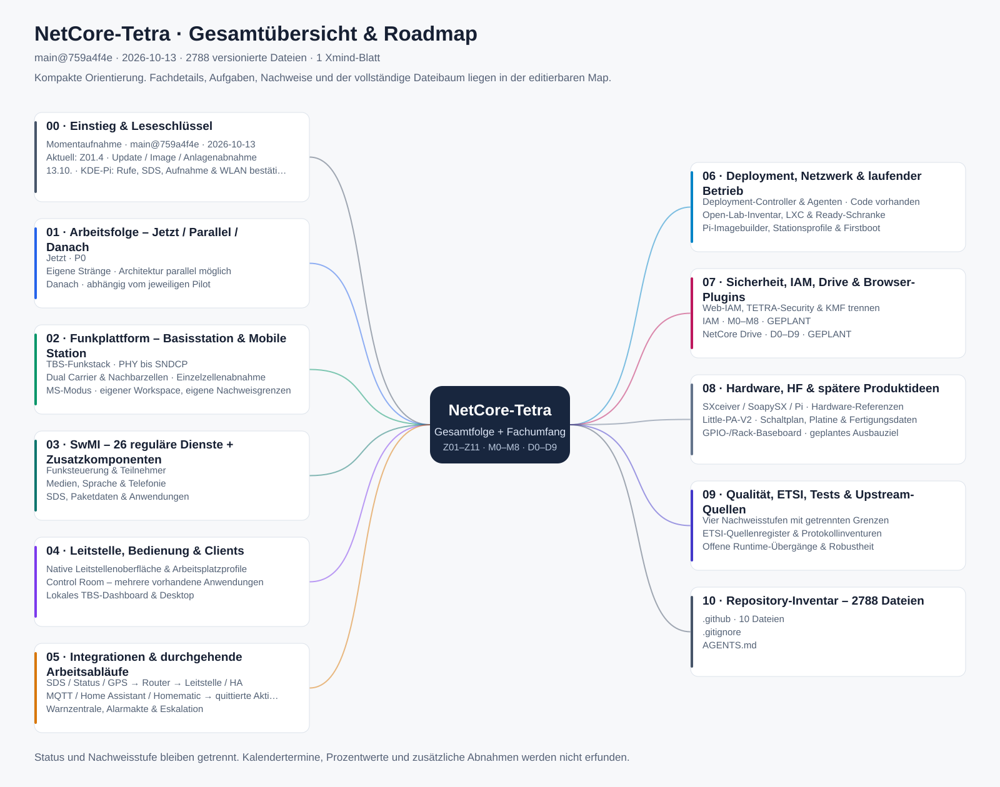

# NetCore-Tetra als Xmind-Gesamtübersicht

[Gesamtroadmap](gesamtroadmap.md) · [Editierbare Xmind-Datei](netcore-tetra-gesamtuebersicht.xmind) · [Übersichtsgrafik](netcore-tetra-gesamtuebersicht.svg)

Die Map verbindet die zentrale Arbeitsfolge, den vorhandenen fachlichen Umfang und ein vollständiges Dateiinventar. Ausgangspunkt ist `main@759a4f4ee989a811c509cd08cd1a3480f9a676f0` vom 13.10.2026 einschließlich PR #77 und des jüngsten KDE-/Pi-Betreiberbelegs. Sie ist eine Momentaufnahme; die gepflegte [Gesamtroadmap](gesamtroadmap.md) bleibt für neue Prioritäts- und Statusentscheidungen maßgeblich. Die Erstellung der Visualisierung ist kein neuer Funk-, Anlagen- oder Implementierungsnachweis.



## Öffnen und navigieren

1. Die `.xmind`-Datei herunterladen und in Xmind über **Datei → Öffnen** öffnen. Sie enthält ein einzelnes Blatt.
2. Mit **00 · Einstieg** beginnen, danach **01 · Arbeitsfolge** aufklappen. Die IDs Z01–Z11, Z01.1–Z01.4, Z02.1–Z02.5 und Z11.1 bleiben erhalten.
3. Fachäste gezielt öffnen. Die IAM-Meilensteine M0–M8 und Drive-Meilensteine D0–D9 stehen unter **07 · Sicherheit, IAM, Drive & Browser-Plugins**.
4. Notizen an Themen öffnen: Dort stehen Abhängigkeiten, Abnahmekriterien, Grenzen, Quellpfade und URLs mit dem vollständigen Quellcommit.
5. **10 · Repository-Inventar** nur bei Bedarf aufklappen. Es enthält alle 2.788 versionierten Dateien des Ausgangsstands samt Pfad, Git-Objekt und Größe. Über einen Dienst-, Datei- oder Aufgabennamen suchen, statt den gesamten Baum gleichzeitig auszuklappen.

Die Gesamtmap enthält 4.196 Themenknoten und acht ausgewählte Beziehungslinien. 26 reguläre Runtime-Dienste und die Zusatzkomponenten werden getrennt eingeordnet. Quellbestand, Aufgabenstatus, datierte Tests und tatsächliche Standort-/On-Air-Abnahme sind getrennte Angaben. Binärassets sind anhand des Git-Baums erfasst; es wird keine inhaltliche oder elektrische Einzelabnahme jedes Assets behauptet.

## Verwendete kostenlose Funktionen

Die Datei beschränkt sich auf ein Blatt, ein normales Mindmap-Layout, Themen und Unterthemen, Einklappen, Klartextnotizen und Beziehungen. Prioritäten, Status und Nachweisstufen sind normaler Text. Quellen-URLs stehen als kopierbarer Klartext in den Notizen.

Es werden keine Premium-Aufgaben, Zuweisungen, Gantt-Felder, Mehrblattplanung, Hyperlink-Elemente, Anhänge oder eigenen Themes verwendet. Die separate SVG-Übersicht entsteht durch den Generator; sie ist kein kostenpflichtiger Xmind-Export. Der ZIP-Container enthält sowohl die moderne JSON-Struktur als auch einen gleichwertigen XML-Themenbaum.

Herstellerreferenzen für den Funktionsumfang und das Dateiformat: [Xmind-Tarife](https://xmind.com/pricing), [Basisfunktionen](https://xmind.app/mindmapping/), [offizieller JSON-Model-Schemaquellbaum](https://github.com/xmindltd/xmind-model/tree/master/schemas) und [offizieller SDK-Dumper](https://github.com/xmindltd/xmind-sdk-js/blob/master/src/utils/dumper.ts). Tarifgrenzen des Onlineprodukts und der Desktopausgabe können sich unterscheiden; diese Map benötigt keine der genannten erweiterten Funktionen.

## Reproduzieren und aktualisieren

Der [Generator](../../tools/generate_xmind_roadmap.py) benötigt Python 3.11 oder neuer und ausschließlich die Standardbibliothek. Er liest die gepflegten Z-/IAM-/Drive-Tabellen, die Registry, das Deployment-Inventory und die MS-Funktionsmatrix. Die fachlichen Einordnungen und die Gruppierung liegen im Generator. Das [Git-Inventar](xmind/repository-inventar.json) fixiert den Umfang und den Quellcommit.

Ab Repository-Root:

```bash
python3 tools/generate_xmind_roadmap.py
python3 tools/generate_xmind_roadmap.py --check
```

`--check` schreibt nichts. Es vergleicht die generierten Dateien bytegenau und prüft eindeutige Themen-IDs, Beziehungen, Aufgabenabdeckung, das vollständige Dateiinventar, JSON-/XML-Gleichheit und das eingeschränkte Free-Funktionsprofil. Ein unveränderter Input ergibt ein unverändertes ZIP; Laufzeitstempel werden nicht eingeschrieben.

Für einen neuen fachlichen Stand zuerst die zentrale Roadmap und relevante Nachweise aktualisieren, Änderungen an der Registry/Komponentengruppierung beurteilen und dann das Inventar mit einem ausdrücklich gewählten Quellcommit erneuern. Die Inventory-JSON behält ihr Schema und enthält die Dateiobjekte aus `git ls-tree -r -l <Quellcommit>`; Commit, Datum, Pfade, Größen und Objekt-SHAs müssen zusammenpassen. Visualisierungsartefakte selbst gehören nur dann zum erfassten Baum, wenn sie in diesem ausdrücklich gewählten Commit bereits vorhanden sind. Kein stiller Wechsel auf den momentanen Arbeitsbaum.

Fachliche Statusänderungen werden in ihren gepflegten Quellen vorgenommen, anschließend wird die Map neu erzeugt. Manuelle Bearbeitung in Xmind ist möglich; ein erneuter Generatorlauf ersetzt diese Änderungen. Für dauerhafte Ergänzungen den Generator bzw. die Originalquelle pflegen. Die SVG ist eine kompakte Orientierung mit wenigen Untertiteln; alle Details liegen in der Xmind-Datei.

Der [Prüfbericht](xmind/pruefbericht.json) hält den Erstellungs- und Validierungsumfang fest. Er ersetzt keinen Livebetrieb oder eine On-Air-Prüfung.
